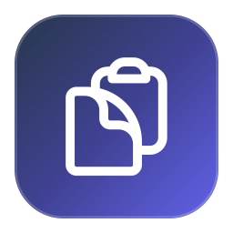
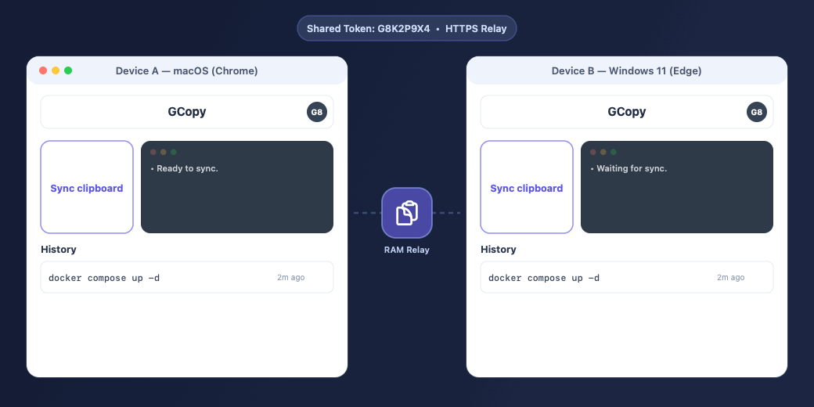
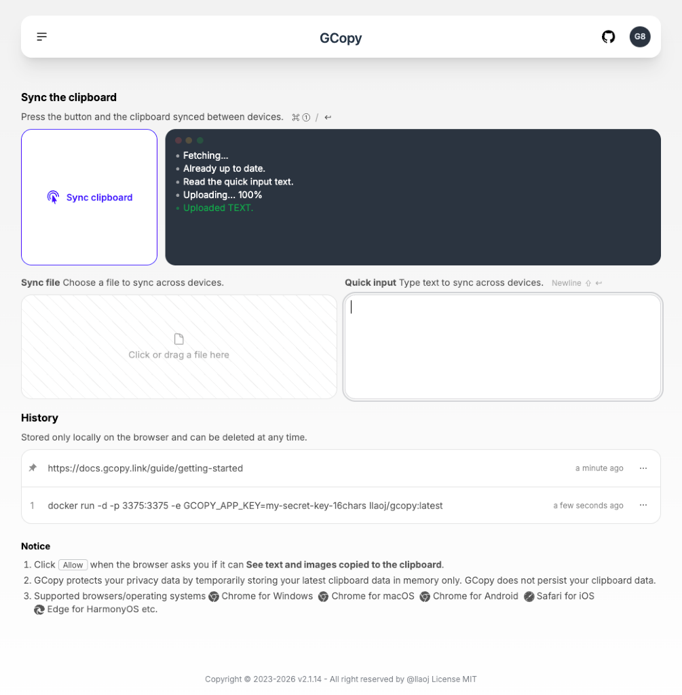
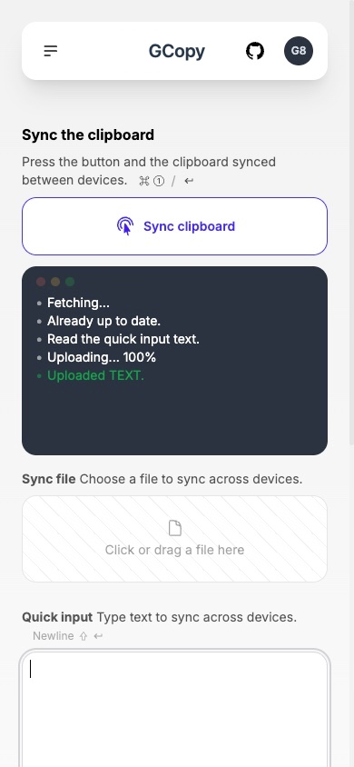

<div align="center">
  
  <h1>GCopy</h1>
  <p><strong>Instant cross-platform clipboard sync for Text, Screenshots & Files — in a single Go binary.</strong></p>

  <p>
    <a href="https://github.com/llaoj/gcopy/actions/workflows/ci.yml"></a>
    <a href="https://github.com/llaoj/gcopy/releases"></a>
    <a href="https://hub.docker.com/r/llaoj/gcopy"></a>
    <a href="https://goreportcard.com/report/github.com/llaoj/gcopy"></a>
    <a href="LICENSE.md"></a>
  </p>

  <p>
    <a href="https://gcopy.link"><strong>🚀 Live Demo</strong></a> ·
    <a href="https://docs.gcopy.link"><strong>📖 Documentation</strong></a> ·
    <a href="docs/zh-CN/README.md"><strong>🇨🇳 中文文档</strong></a> ·
    <a href="https://discord.gg/pyTrT3aAaC"><strong>💬 Discord</strong></a>
  </p>

  
</div>

---

## ✨ Why GCopy?

Working across a macOS laptop, a Windows PC, and a phone at the same time shouldn't hurt. Most existing tools break down on locked-down office machines or isolated corporate VLANs:

| Feature | **GCopy** | LocalSend / AirDrop | Chat Apps (WeChat / Slack) |
| :--- | :--- | :--- | :--- |
| **Client Installation** | **None (Web Browser)** | Requires native app / Apple-only | Requires logging into personal account |
| **Network Requirement** | **Any network (cross-VLAN / Internet / LAN)** | Same Wi-Fi / LAN multicast required | Internet required |
| **Supported Payloads** | **Text, Lossless Screenshots & Multi-File (`.zip`)** | Files & Text | Compresses images unless sent as file |
| **Server Persistence** | **RAM-only (0 DB, 24h auto-expire)** | P2P | Stored on vendor cloud servers |
| **Self-Host Footprint** | **Single Go binary (~10 MB) / 1 Docker container** | N/A | N/A |

### Key Highlights

- **📋 Text, Screenshots & Multi-File**: Sync plain text, direct OS screenshots (with automatic `Ctrl+V` fallback for non-standard clipboard images like WeChat), and drag-and-drop multiple files (automatically zipped in the browser).
- **🌐 Zero Network Friction**: Pair any two devices with an **8-character token** (or scan the login QR code). Works seamlessly across isolated corporate subnets, VPNs, 4G/5G mobile data, and home labs.
- **🛡️ Ephemeral In-Memory Design**: No database, no disk storage. Clipboard payloads live strictly in Go server memory and expire automatically after 24 hours of inactivity. Local history is stored only in your own browser's IndexedDB.
- **⚡ Single-Binary Deployment**: Static Next.js frontend embedded into one Go binary via `go:embed` — zero Nginx or Node.js runtime required.

---

## 🚀 Quick Start

### 1. Try Online Immediately

Open **[https://gcopy.link](https://gcopy.link)** in your browser on two devices, sign in with the same 8-character token, and press **Sync clipboard** (or `Enter`).

### 2. Sync from SSH / Terminal (`curl`)

No CLI client required — push or pull straight from any remote Linux server using your 8-character token:

```bash
# Push command output from SSH server -> your local clipboard
cat app.log | curl -fsSL https://gcopy.link/api/v1/clipboard -H "Authorization: Bearer YOUR_TOKEN" --data-binary @-

# Pull your clipboard -> terminal
curl -fsSL https://gcopy.link/api/v1/clipboard -H "Authorization: Bearer YOUR_TOKEN"
```

See **[CLI, SSH & iOS Shortcuts Guide](https://docs.gcopy.link/guide/cli)** for file uploads, shell aliases, and iPhone Back-Tap automation.

### 3. Self-Host in 30 Seconds (Docker)

> [!NOTE]
> Modern browsers require **HTTPS** (Secure Context) to grant Clipboard API access. You can use GCopy's built-in TLS flags or place it behind Caddy / Nginx / Cloudflare Tunnel.

```bash
# 1. Generate a quick self-signed cert (or bring your own domain cert / reverse proxy)
curl -sSL https://raw.githubusercontent.com/llaoj/gcopy/main/scripts/gen-cert.sh | bash

# 2. Run the all-in-one container
docker run -d \
  --name gcopy \
  --restart unless-stopped \
  -p 3375:3375 \
  -v $(pwd)/cert.pem:/cert.pem:ro \
  -v $(pwd)/key.pem:/key.pem:ro \
  -e GCOPY_APP_KEY=your-secret-key-min-16-chars \
  -e GCOPY_TLS_CERT_FILE=/cert.pem \
  -e GCOPY_TLS_KEY_FILE=/key.pem \
  llaoj/gcopy:latest
```

Prefer prebuilt binaries (`linux` / `darwin` / `windows`, `amd64` & `arm64`) or building from source? See the full guides:
- **[Deploy by Docker](https://docs.gcopy.link/deploy-by-docker)**
- **[Deploy from Binary / Source](https://docs.gcopy.link/deploy-from-source)**

---

## 🖥️ Screenshots

<table>
  <tr>
    <th width="68%">Desktop (macOS / Windows / Linux)</th>
    <th width="32%">Mobile (iOS / Android)</th>
  </tr>
  <tr>
    <td></td>
    <td></td>
  </tr>
</table>

---

## 🌐 Browser Compatibility

GCopy builds on the standard [W3C Clipboard API](https://developer.mozilla.org/en-US/docs/Web/API/Clipboard#browser_compatibility) with tailored handling for Safari user-gesture windows and mobile browsers:

| Browser | Tested Version | Status |
| :--- | :--- | :--- |
| Chrome (macOS / Windows / Android) | 107+ / 121+ | ✅ Tested |
| Edge (Windows / Linux / Android / HarmonyOS) | 108+ / 122+ / 130+ | ✅ Tested |
| Safari (macOS / iOS) | 15.6+ / 16.1+ | ✅ Tested |
| Opera (macOS / Windows) | 109+ | ✅ Tested |

### Notes & Limits
- Browsers do not expose raw OS file paths to `navigator.clipboard`, so files are synced smoothly via drag-and-drop upload and automatic browser download (multiple files are zipped automatically).
- Maximum payload size defaults to `10 MiB` (configurable via `-max-content-length` / `GCOPY_MAX_CONTENT_LENGTH`).

---

## ☕ Sponsor & Community

GCopy maintains a free public instance at [gcopy.link](https://gcopy.link). If GCopy saves you time every day, consider supporting the project:

- Give a **[GitHub Star](https://github.com/llaoj/gcopy)** ⭐
- **[Buy me a coffee](https://docs.gcopy.link/sponsor)** ☕
- **Email**: [hmmmbiubiubiu@gmail.com](mailto:hmmmbiubiubiu@gmail.com)
- **Discord**: [https://discord.gg/pyTrT3aAaC](https://discord.gg/pyTrT3aAaC)

## 📄 License

Released under the [MIT License](LICENSE.md).
