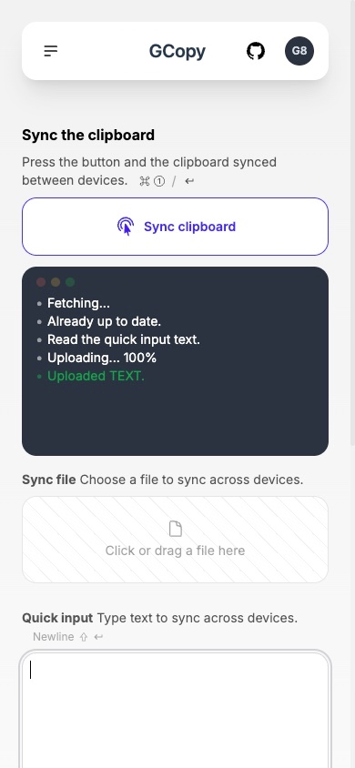

# FAQ & Browser Compatibility

## Why does GCopy require HTTPS?

GCopy relies on the modern [W3C Clipboard API](https://developer.mozilla.org/en-US/docs/Web/API/Clipboard), which browsers strictly restrict to **Secure Contexts** (`https://` or `http://localhost`). Plain `http://<lan-ip>` will disable `navigator.clipboard`, so self-hosted deployments must enable TLS (built-in cert or reverse proxy).

## Why does Safari ask me to "Press again"?

Safari (on both macOS and iOS) enforces a strict transient user-activation policy: `navigator.clipboard.read()` and `navigator.clipboard.write()` must be invoked synchronously inside a direct click gesture, not after a slow network round-trip.

When GCopy first checks `/api/v1/clipboard` and discovers whether it needs to read or write, Safari's gesture window may have expired. Pressing the button a second time executes the clipboard operation immediately within the fresh gesture.

## Why does GCopy ask me to press `Ctrl+V` / `Cmd+V` for some images?

Certain desktop applications (like WeChat) write non-standard MIME entries to the OS clipboard. Browsers strip those entries from `navigator.clipboard.read()` for security reasons, making the clipboard appear empty. Pressing `Ctrl+V` / `Cmd+V` triggers the standard `paste` event (`DataTransfer`), allowing GCopy to read the image safely.

## Does GCopy store my data on disk?

No. All synchronized payloads live exclusively in the Go server's memory (`Wall`) and expire automatically after **24 hours** of inactivity. Restarting the server clears all in-memory data immediately.

## Tested Browsers

| Browser | Tested Version | Status |
| :--- | :--- | :--- |
| Chrome for macOS / Windows / Android | 107+ / 121+ | ✅ Tested |
| Edge for Windows / Linux / Android / HarmonyOS | 108+ / 122+ / 130+ | ✅ Tested |
| Safari for macOS | 15.6+ | ✅ Tested |
| Safari for iOS | 16.1+ | ✅ Tested |
| Opera for macOS / Windows | 109+ | ✅ Tested |
