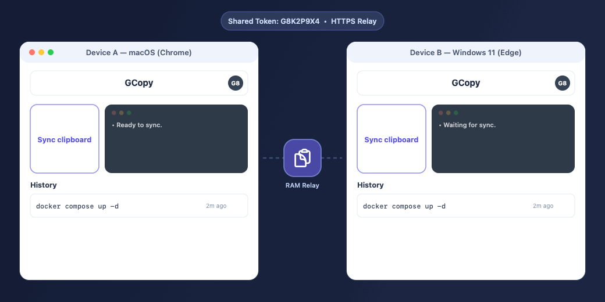

# Getting Started

GCopy is a web-based cross-platform clipboard synchronization tool. Without installing native apps on corporate or personal machines, you can transfer **text**, **screenshots**, and **files** across Windows, macOS, Linux, iOS, and Android in seconds.

## How It Works

1. **Generate or Enter an 8-Character Token**: Open [https://gcopy.link](https://gcopy.link) (or your self-hosted URL) on Device A, generate an 8-character token, and sign in with the same token on Device B (or scan the QR code from the top-right avatar menu).
2. **Push from Device A**: Copy text or take a screenshot (`Ctrl+C` / `Cmd+C`), then click **Sync clipboard** (or press `Enter`).
3. **Pull on Device B**: Switch to Device B, click **Sync clipboard**, and paste (`Ctrl+V` / `Cmd+V`) anywhere!

> [!TIP]
> You can quickly log in on your phone by clicking your avatar in the top-right corner and scanning the **Login QR Code**.

## Supported Content Types

### 1. Text & Quick Input
- Copy text in any app and click **Sync clipboard** to push it.
- Or expand **Quick input** on the page to type/paste text directly without overwriting your system clipboard.

### 2. Screenshots & Special Images (e.g. WeChat)
- Standard screenshots (`Cmd+Shift+Control+4` on macOS, `Win+Shift+S` on Windows) are read directly via the browser Clipboard API and converted to lossless PNG for cross-platform compatibility.
- **Special clipboard formats**: Some desktop apps (such as WeChat) place non-standard image formats on the clipboard that browsers sanitize during async reads. GCopy automatically detects this and prompts you to press `Ctrl+V` / `Cmd+V` on the page to capture the raw image seamlessly.

### 3. Single & Multiple Files
- Drag and drop one or multiple files into the **Sync the files** dropzone (or click **Choose a file**).
- When multiple files are selected, GCopy automatically packages them into a `.zip` archive in the browser before uploading.
- On the receiving device, clicking **Sync clipboard** downloads the file automatically.

## Local History & Pinning

- Synchronized items are cached **only in your local browser's IndexedDB** (never persisted on the server).
- Click the `...` menu on any history item to copy it back to your local clipboard, re-share it to other devices, **Pin** important snippets so they aren't evicted, or delete them at any time.

## Next Steps

- Want to host your own private instance? Check out [Deploy by Docker](/deploy-by-docker) or [Deploy from Source](/deploy-from-source).
- Running into browser permission prompts on Safari or mobile? Read [FAQ & Compatibility](/guide/faq).
