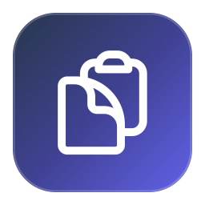
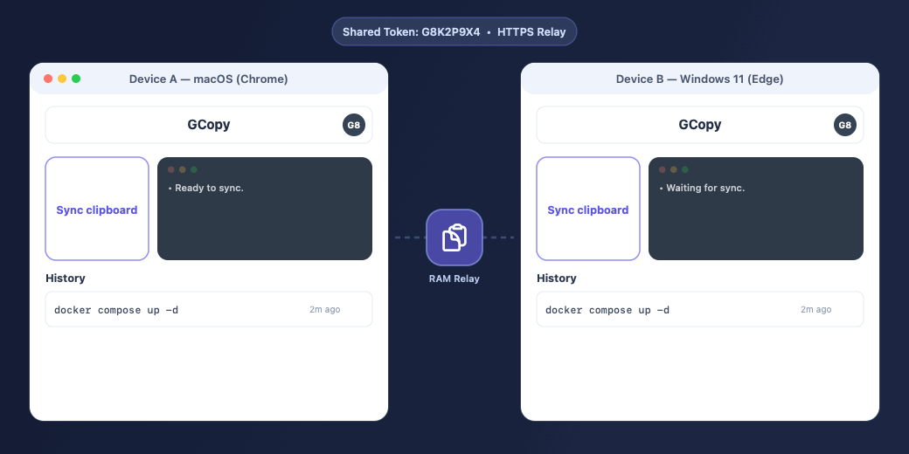
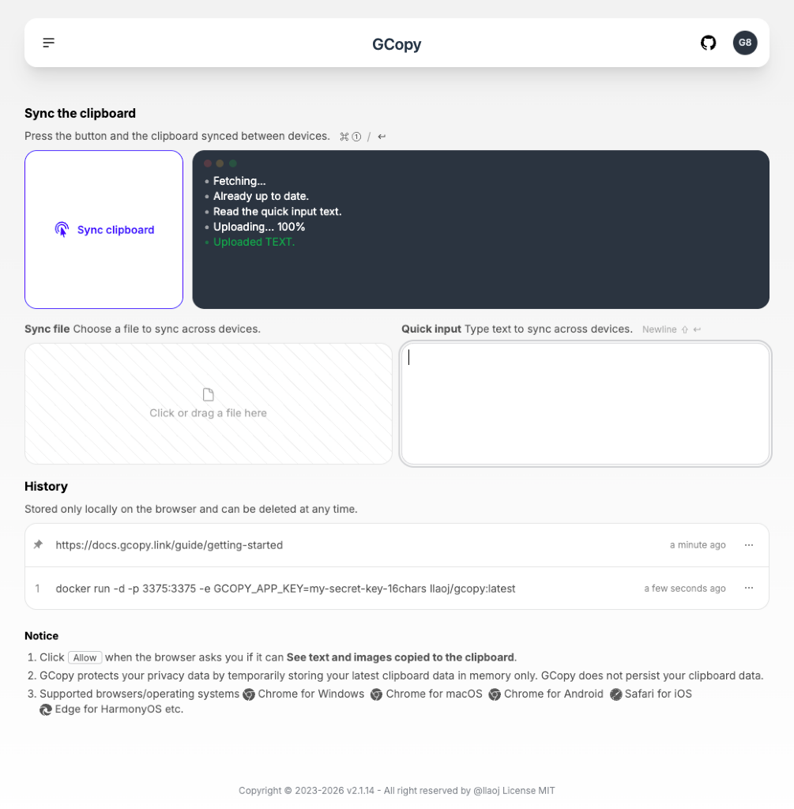
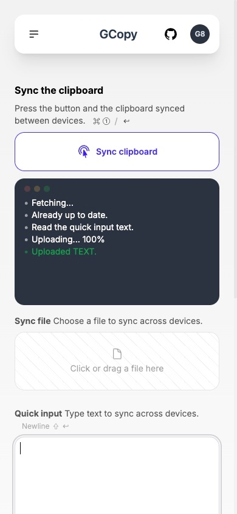

<div align="center">
  
  <h1>GCopy</h1>
  <p><strong>跨系统剪贴板无缝同步服务 —— 支持文字、截图与多文件，单一 Go 二进制极简部署。</strong></p>

  <p>
    <a href="https://github.com/llaoj/gcopy/actions/workflows/ci.yml"></a>
    <a href="https://github.com/llaoj/gcopy/releases"></a>
    <a href="https://hub.docker.com/r/llaoj/gcopy"></a>
    <a href="https://goreportcard.com/report/github.com/llaoj/gcopy"></a>
    <a href="../../LICENSE.md"></a>
  </p>

  <p>
    <a href="https://gcopy.link"><strong>🚀 立即在线体验</strong></a> ·
    <a href="https://docs.gcopy.link/zh-CN/"><strong>📖 官方文档站</strong></a> ·
    <a href="../../README.md"><strong>🇺🇸 English</strong></a> ·
    <a href="https://discord.gg/pyTrT3aAaC"><strong>💬 Discord</strong></a>
  </p>

  
</div>

---

## ✨ 为什么选择 GCopy？

日常同时操作 Windows 电脑、MacBook 和手机时，跨设备传一段文字、一张截图或几个文件往往非常折腾——公司办公网通常开启了 AP/VLAN 隔离导致局域网工具失效，而在公共或办公电脑上又不想登录个人微信：

| 对比维度 | **GCopy** | LocalSend / AirDrop | 微信 / IM 文件传输助手 |
| :--- | :--- | :--- | :--- |
| **客户端安装** | **免安装（浏览器即开即用）** | 需全端装客户端 / 仅限苹果生态 | 需在办公机登录个人社交账号 |
| **网络环境要求** | **不限局域网（跨隔离网段 / 公网 / 内网皆可）** | 强依赖同局域网与组播互通 | 依赖外网连接 |
| **支持内容类型** | **文字、无损截图（含微信特殊图片）、多文件自动打包** | 文件与文本 | 直接发图默认有损压缩 |
| **服务端数据留存** | **纯内存瞬时中转（无数据库，24h 自动销毁）** | 局域网点对点 | 留存在第三方云端聊天记录 |
| **私有部署体积** | **单一 Go 二进制（~10 MB）/ 单 Docker 容器** | 不支持中转自建 | 不支持自建 |

### 核心亮点

- **📋 文字、截图与多文件全支持**：原生同步普通文本、系统截图（针对微信等非标剪贴板图片提供 `Ctrl+V` 自动粘贴兜底）以及单文件/多文件自动 `.zip` 打包传输。
- **🌐 8 位令牌秒级配对**：两台设备输入同一个 8 位字符令牌（或点击右上角头像直接用手机扫码登录），即可跨网段共享剪贴板。
- **🛡️ 重视隐私，纯内存运行**：无数据库、不落盘持久化。服务端数据仅保存在 Go 进程内存中，24 小时不活跃自动清理；历史记录仅保存在你当前浏览器的本地 IndexedDB。
- **⚡ 单文件零依赖架构**：Next.js 前端静态资源通过 `go:embed` 直接嵌入单个 Go 二进制文件，无需额外部署 Node.js 或 Nginx。

---

## 🚀 快速开始

### 1. 直接在线使用

在两台设备的浏览器中打开 **[https://gcopy.link](https://gcopy.link)**，使用相同的 8 位令牌登录，复制内容后按页面右侧的 **同步剪贴板** 按钮（或直接按 `Enter`）即可同步！

### 2. 从远程 SSH 服务器同步（`curl` 免安装）

无需额外部署命令行客户端，在任何 Linux 服务器终端一行 `curl` 即可与本地电脑剪贴板互通：

```bash
# 将远程服务器上的日志或文本直接推入本地剪贴板
cat app.log | curl -fsSL https://gcopy.link/api/v1/clipboard -H "Authorization: Bearer 你的8位令牌" --data-binary @-

# 在远程服务器终端拉取电脑刚复制的内容
curl -fsSL https://gcopy.link/api/v1/clipboard -H "Authorization: Bearer 你的8位令牌"
```

更多传文件、`gpush`/`gpull` 快捷别名及 iPhone 轻点背面自动同步配置，请查看 **[命令行与快捷指令指南](https://docs.gcopy.link/zh-CN/guide/cli)**。

### 3. 30 秒私有部署（Docker）

> [!NOTE]
> 现代浏览器的 Clipboard API 强制要求 **HTTPS** 安全上下文。你可以使用 GCopy 内置的 TLS 参数，也可以配合 Caddy / Nginx / Cloudflare Tunnel 提供 HTTPS。

```bash
# 1. 快速生成自签名证书（生产环境也可挂载正式域名证书或使用反向代理）
curl -sSL https://raw.githubusercontent.com/llaoj/gcopy/main/scripts/gen-cert.sh | bash

# 2. 启动单容器服务（国内也可拉取 registry.cn-beijing.aliyuncs.com/llaoj/gcopy:latest）
docker run -d \
  --name gcopy \
  --restart unless-stopped \
  -p 3375:3375 \
  -v $(pwd)/cert.pem:/cert.pem:ro \
  -v $(pwd)/key.pem:/key.pem:ro \
  -e GCOPY_APP_KEY=your-secret-key-min-16-chars \
  -e GCOPY_TLS_CERT_FILE=/cert.pem \
  -e GCOPY_TLS_KEY_FILE=/key.pem \
  llaoj/gcopy:latest
```

想直接下载单文件可执行包（支持 `linux` / `darwin` / `windows` 的 `amd64` 与 `arm64`）或查看反向代理配置？请阅读完整文档：
- **[使用 Docker 部署](https://docs.gcopy.link/zh-CN/deploy-by-docker)**
- **[二进制与源码部署](https://docs.gcopy.link/zh-CN/deploy-from-source)**

---

## 🖥️ 界面预览

<table>
  <tr>
    <th width="68%">桌面端 (macOS / Windows / Linux)</th>
    <th width="32%">移动端 (iOS / Android)</th>
  </tr>
  <tr>
    <td></td>
    <td></td>
  </tr>
</table>

---

## 🌐 浏览器兼容性

GCopy 基于标准 [Clipboard API](https://developer.mozilla.org/zh-CN/docs/Web/API/Clipboard#browser_compatibility) 构建，并针对 Safari 手势窗口和移动端浏览器做了专门适配：

| 浏览器 | 测试版本 | 状态 |
| :--- | :--- | :--- |
| Chrome (macOS / Windows / Android) | 107+ / 121+ | ✅ 已测试 |
| Edge (Windows / Linux / Android / HarmonyOS) | 108+ / 122+ / 130+ | ✅ 已测试 |
| Safari (macOS / iOS) | 15.6+ / 16.1+ | ✅ 已测试 |
| Opera (macOS / Windows) | 109+ | ✅ 已测试 |

### 说明与限制
- 由于浏览器安全沙箱不允许网页直接读写系统文件路径，文件同步通过拖拽/选择上传与自动下载完成（多文件自动打包为 `.zip`）。
- 默认单次最大同步体积为 `10 MiB`（可通过 `-max-content-length` / `GCOPY_MAX_CONTENT_LENGTH` 自定义）。

---

## ☕ 感谢支持与社区交流

GCopy 需要购买公有云服务来维持在线体验站 [gcopy.link](https://gcopy.link) 的运行。如果您觉得 GCopy 对您有帮助，希望各位义父支持一下：

- 给个 **[GitHub Star](https://github.com/llaoj/gcopy)** ⭐
- 或者捐赠一笔（1 块钱不嫌少，1 万块不嫌多 😄）👉 **[打赏杯咖啡吧](https://docs.gcopy.link/zh-CN/sponsor)**

### 联系方式

- **联系邮箱**：[hmmmbiubiubiu@gmail.com](mailto:hmmmbiubiubiu@gmail.com)
- **Discord**：[https://discord.gg/pyTrT3aAaC](https://discord.gg/pyTrT3aAaC)
- **微信交流群**：添加我的微信拉你进群，这里已经聚集了一帮有意思的朋友：


## 📄 开源协议

基于 [MIT License](../../LICENSE.md) 开源发布。
