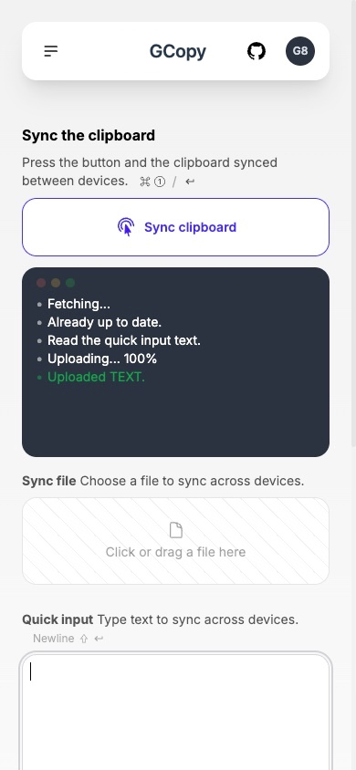

# 常见问题与浏览器兼容性

## 为什么自建部署必须配置 HTTPS？

GCopy 依赖现代浏览器的 [Clipboard API](https://developer.mozilla.org/zh-CN/docs/Web/API/Clipboard)。出于浏览器安全策略限制，除 `localhost` 外，所有局域网 IP 或公网域名都必须在 **HTTPS 安全上下文**下才能调用剪贴板读写接口。因此自建部署时请配置内置 TLS 证书或通过 Caddy / Nginx / Cloudflare Tunnel 提供 HTTPS。

## 为什么在 Safari 上有时提示「请再按一次」？

macOS 和 iOS 上的 Safari 对剪贴板权限有严格的用户手势时效要求：读写剪贴板必须在点击事件的极短同步窗口内触发。当 GCopy 先向服务器请求判断同步方向后，网络耗时可能导致手势令牌失效，此时按提示再点一下按钮即可在全新手势中瞬间完成读写。

## 为什么复制微信图片后会提示按 `Ctrl+V` / `Cmd+V`？

部分桌面客户端（如微信）写入系统剪贴板的图片格式不标准，浏览器的异步 `navigator.clipboard.read()` 接口出于安全清洗策略会返回空数组。此时按照提示直接按 `Ctrl+V`（Mac 按 `Cmd+V`），GCopy 会通过页面原生 `paste` 事件读取原始图片数据并完成上传。

## 我的剪贴板数据会被服务器持久化保存吗？

不会。GCopy 不使用任何数据库，也不将剪贴板内容写入磁盘。所有数据仅暂存在 Go 服务端的内存中，若 **24 小时**内无更新会自动过期清理；容器重启也会立即清空全部内存数据。

## 已测试浏览器列表

| 浏览器 | 测试版本 | 状态 |
| :--- | :--- | :--- |
| Chrome (macOS / Windows / Android) | 107+ / 121+ | ✅ 已测试 |
| Edge (Windows / Linux / Android / HarmonyOS) | 108+ / 122+ / 130+ | ✅ 已测试 |
| Safari (macOS) | 15.6+ | ✅ 已测试 |
| Safari (iOS) | 16.1+ | ✅ 已测试 |
| Opera (macOS / Windows) | 109+ | ✅ 已测试 |
