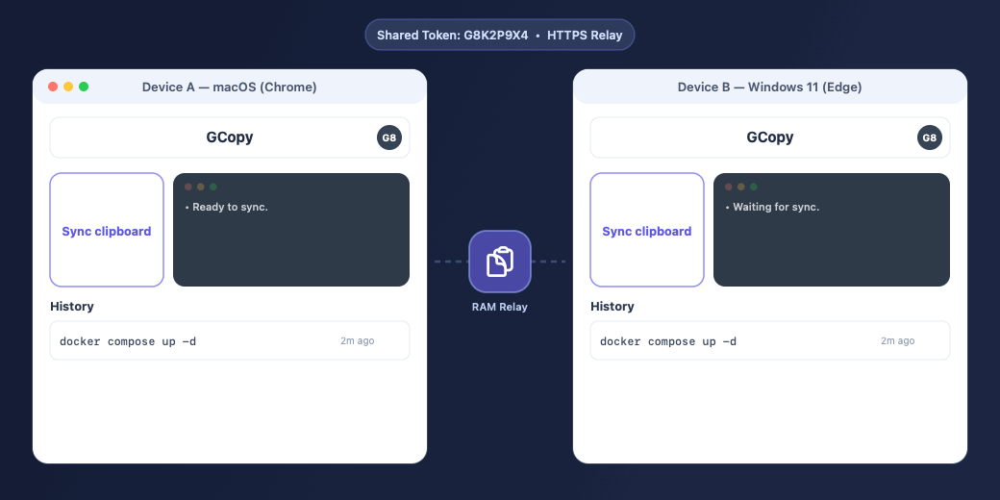

# 快速上手

GCopy 是一个基于 Web 的跨平台剪贴板同步工具。无需在办公电脑或个人设备上安装客户端，即可在 Windows、macOS、Linux、iOS 和 Android 之间秒级同步**文字**、**截图**和**文件**。

## 三步开始使用

1. **使用同一个 8 位令牌登录**：在设备 A 打开 [https://gcopy.link](https://gcopy.link)（或你的私有部署地址），生成一个 8 位字符令牌；在设备 B 输入相同令牌登录（也可以点击右上角头像直接用手机**扫码登录**）。
2. **在设备 A 推送**：复制文字或截图（`Ctrl+C` / `Cmd+C`），点击页面右侧的 **同步剪贴板** 按钮（或直接按快捷键 `Enter`）。
3. **在设备 B 拉取**：切换到设备 B（当远端有新内容时按钮会出现提示），点击 **同步剪贴板**，即可直接粘贴（`Ctrl+V` / `Cmd+V`）！

> [!TIP]
> 点击页面右上角的圆形头像菜单，可以一键复制你的 8 位令牌、复制免输密登录链接，或直接用手机扫码登录。

## 支持同步的数据类型

### 1. 文本与快捷输入
- 在任意软件复制文字后点击同步按钮即可上传。
- 如果不想覆盖本机系统剪贴板，也可以展开页面上的**快捷输入**框直接输入文字并发送。

### 2. 系统截图与特殊图片（如微信图片）
- 系统原生截图（macOS `Cmd+Ctrl+Shift+4`、Windows `Win+Shift+S`）会通过浏览器 Clipboard API 直接读取并统一转为标准 PNG 格式，保证各系统都能直接粘贴。
- **微信图片等特殊格式自动兜底**：部分桌面软件（如微信）复制的图片会被浏览器的异步剪贴板接口过滤为空。GCopy 检测到该情况后会自动提示按一下 `Ctrl+V` / `Cmd+V`，通过同步粘贴事件无损提取原图并上传。

### 3. 单文件与多文件打包
- 支持点击选择或直接拖拽一个、多个文件到**同步文件**区域。
- 当你一次拖入多个文件时，GCopy 会在浏览器本地自动打包为 `.zip` 后上传；接收端点击同步按钮后会自动触发文件下载。

## 本地历史记录与置顶

- 同步过的历史记录**仅保存在当前浏览器的本地 IndexedDB 中**，服务端不留存历史列表。
- 你可以在历史记录右侧菜单中随时重新写回本机剪贴板、重新共享给其他设备、**置顶（Pin）**常用内容防止被自动清理，或随时手动删除。

## 下一步

- 想要搭建完全私有的个人/团队实例？请查看 [使用 Docker 部署](/zh-CN/deploy-by-docker) 或 [二进制与源码部署](/zh-CN/deploy-from-source)。
- 遇到 Safari 再次点击提示或剪贴板权限问题？请查看 [常见问题与兼容性](/zh-CN/guide/faq)。
